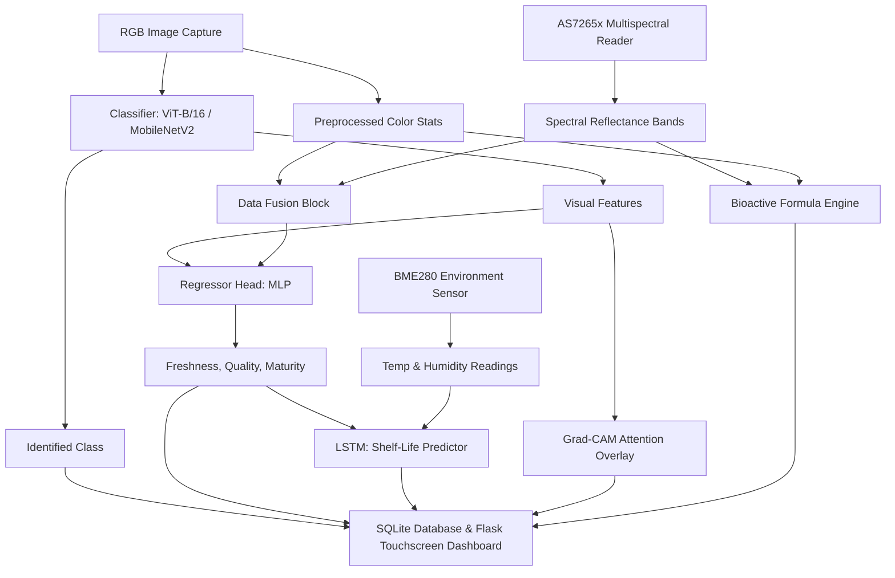

# AgriCompoundAI

AgriCompoundAI is a complete, AI-powered multispectral plant and vegetable quality analysis system designed to run on a **Raspberry Pi 5** with a 7" Touchscreen. It also features a full **Simulation Mode** fallback so it runs and demos out-of-the-box on standard development machines with no hardware attached.

The system fuses RGB camera imagery, multispectral sensor data, and environmental readings, then passes them through deep learning architectures and explainable AI to classify the plant, grade its quality, estimate bioactive compounds, and predict remaining shelf life.

---

> [!WARNING]  
> **DISCLAIMER**: Bioactive compound estimates (chlorophyll, lycopene, curcumin, anthocyanins) generated by this system are AI-derived approximations for research and educational purposes. They are **NOT** certified laboratory measurements (such as HPLC/spectroscopy) and should **NOT** be used for clinical diagnostic purposes or medical advice.

---

## System Architecture



## Features

- **Plant Classifier**: Leverages a Vision Transformer (`ViT-B/16`) backbone, automatically falling back to `MobileNetV2` if ViT weights are unavailable or slow to load.
- **Quality Regressor**: Fuses visual backbone features with 18-channel spectral bands and computed indices (NDVI, Water Band Index, Chlorophyll Index) to predict freshness %, overall quality, and maturity.
- **Shelf Life Predictor**: Uses an LSTM network over a historical sequence of readings to estimate remaining shelf life (0 to 15 days) under fluctuating temperatures and humidity.
- **Bioactive Compound Estimation**: Employs transparent linear formulas matching spectral absorption bands (e.g., chlorophyll dips at 430/660nm, red-edge rises) to calculate pigment concentrations.
- **Explainable AI (XAI)**: Renders a Grad-CAM heatmap overlay showing attention maps and generates a plain-language explanation of the system's output.
- **Touchscreen Dashboard**: Served on a Flask web server, displaying camera streams, interactive Chart.js spectral curves, progress gauges, and historical decay logs.

## Project Structure

```
AgriCompoundAI/
├── dataset/                    # Dataset loaders and mock data generator
│   ├── dataset_loader.py
│   └── generate_mock_dataset.py
├── database/                   # SQLite database logger
│   └── db_manager.py
├── hardware/                   # Physical camera and BME280 integrations
│   ├── camera_capture.py
│   └── environment_sensor.py
├── multispectral/              # Multispectral AS7265x/AS7341 I2C driver
│   └── sensor_reader.py
├── preprocessing/              # Data preprocessing and feature fusion
│   ├── image_preprocessing.py
│   ├── spectral_preprocessing.py
│   └── data_fusion.py
├── models/                     # Deep learning model definitions
│   ├── plant_classifier.py
│   ├── quality_regressor.py
│   └── shelf_life_lstm.py
├── training/                   # PyTorch training loops
│   ├── train_classifier.py
│   ├── train_regressor.py
│   └── train_lstm.py
├── inference/                  # Unified prediction pipeline
│   └── predictor.py
├── xai/                        # Grad-CAM heatmap & explanation reports
│   └── explainability.py
├── web/                        # Touchscreen UI assets and templates
│   ├── static/
│   │   ├── css/
│   │   │   └── style.css
│   │   ├── js/
│   │   │   └── dashboard.js
│   │   └── images/             # Seed stock images for simulation
│   ├── templates/
│   │   └── index.html
│   └── routes.py
├── utils/                      # Configurations and logger
│   ├── config.py
│   └── logger.py
├── requirements.txt            # Project dependencies
├── app.py                      # Main Flask application launcher
└── train.py                    # Master training orchestrator
```

## Setup & Running

### 1. Install Dependencies
Initialize your environment and run the following command to download the packages:
```bash
pip install -r requirements.txt
```
*Note: If installing PyTorch on a development machine with limited bandwidth/CPU, you can download a smaller CPU-only bundle:*
```bash
pip install torch torchvision --index-url https://download.pytorch.org/whl/cpu
pip install Flask numpy pandas opencv-python matplotlib
```

### 2. Generate Dataset & Train Models (Optional)
Run the master training orchestrator to populate `dataset/` with mock images/sequences and train the three models:
```bash
python train.py
```
This will train the models for a few quick epochs and export weights to `models/weights/`.

### 3. Launch the Dashboard
Start the Flask web dashboard:
```bash
python app.py
```
By default, this launches in **Simulation Mode** using environment variables. Access the UI at `http://localhost:5000`.

---

## Hardware Configuration (Raspberry Pi 5)
To deploy on physical hardware, set the mode environment variable:
```bash
$env:AGRICOMPOUND_HW_MODE="pi"  # On Windows PowerShell
export AGRICOMPOUND_HW_MODE="pi" # On Linux/Raspberry Pi Terminal
```

Ensure the following components are connected to your Raspberry Pi 5:
1. **Camera Module 3**: Enabled via libcamera / picamera2.
2. **AS7265x Multispectral Sensor**: Connected to `SDA/SCL (I2C-1)` pins. Base address `0x49`.
3. **BME280 Sensor**: Connected to I2C pins. Base address `0x76`.
4. **Touchscreen**: Plugged into HDMI or DSI port.
